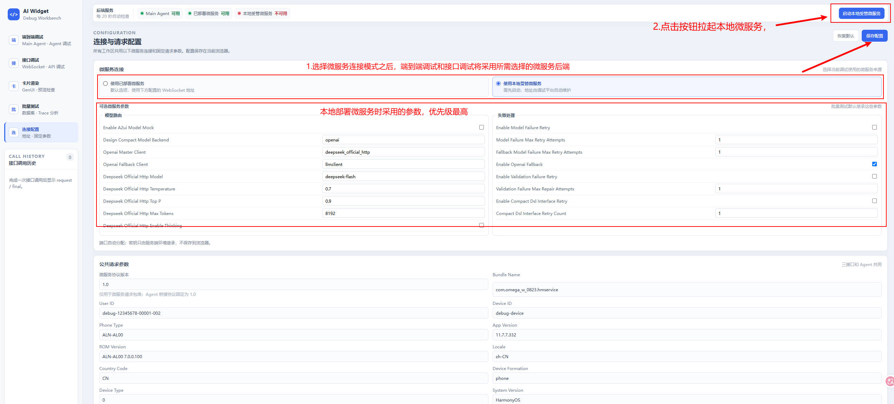
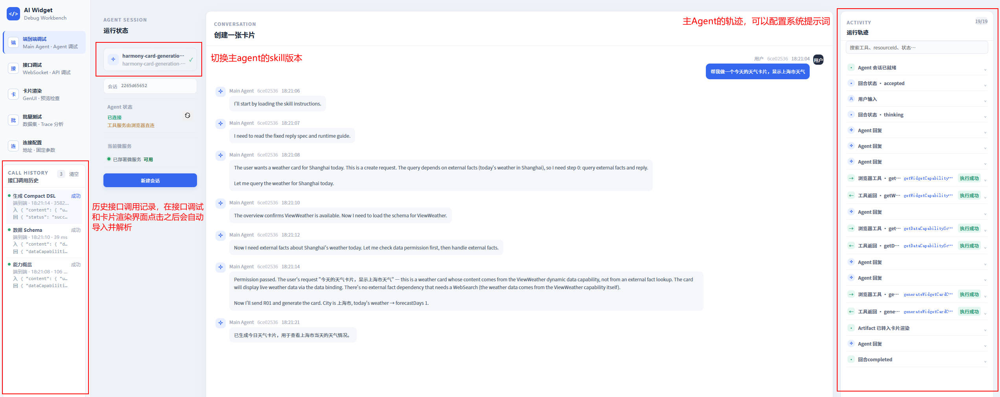
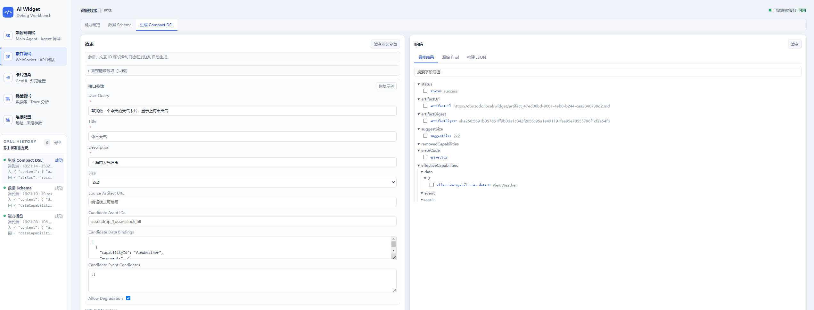
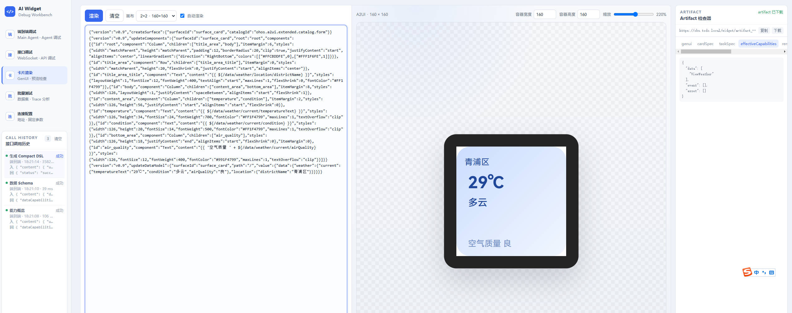
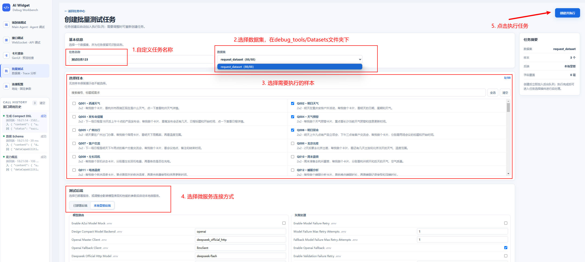

# AI Widget 调试工作台

## 本机配置

缺少 `debug_tool.yaml` 时仍可启动工作台，连接配置页会显示配置缺失提醒；设备渲染和截图暂不可用，
模型调用仍需有效配置。在仓库根目录执行以下命令创建本机配置；已有配置时不要覆盖：

```powershell
Copy-Item debug_tools/debug_tool.yaml.example debug_tools/debug_tool.yaml
```

macOS / Linux 可执行 `cp -n debug_tools/debug_tool.yaml.example debug_tools/debug_tool.yaml`。
随后按模板中的字段说明填写本机路径、模型通道及运行参数，再启动调试平台。
模板使用保留类型的示例值，路径和设备信息需要替换；空凭据不代表接口可直接调用。
模型密钥请在本机配置或 `widget_service/.env` 中填写，不要放入示例模板。
受管服务的 `widget_backend` 优先级高于 `.env`，不要在其中用空密钥覆盖有效凭据。
端到端 Main Agent 与本地受管微服务共用 `widget_backend` 配置，不再维护或读取 `main_agent.model`。
旧配置请将需要保留的模型参数放入 `widget_backend.defaults` 或已有的 `widget_backend.exposed`，
同一参数只维护一处；模型密钥须与所选通道对应。修改后重启调试服务和本地受管微服务。
`platform.server.bundle_name` 必须与所选 Skill 的工具声明及工具快照一致；项目内置在线 Skill 使用
`com.omega_w_0823.hmservice`。出现“frontmatter 工具 bundle 与 Debug 配置不一致”时，检查该项并重启服务。

仓库只维护 [`debug_tool.yaml.example`](debug_tool.yaml.example)。实际 `debug_tool.yaml` 已加入
`.gitignore`，连接配置页保存的修改只留在本机。更新已有工作区前请备份自己的配置。

## 本机 Node 与 DevEco 环境

调试平台的本机工具链统一配置在 `debug_tool.yaml` 的 `platform.environment`：

```yaml
platform:
  environment:
    deveco_studio_home: D:/Env/DevEco Studio
    node_executable: ${environment.deveco_studio_home}/tools/node/node.exe
    sdk_home: ${environment.deveco_studio_home}/sdk
    hdc: ${environment.sdk_home}/default/openharmony/toolchains/hdc.exe
```

`node_executable` 应通过 YAML 配置完整路径；未配置时才尝试系统 `PATH`。
Node、DevEco 等外部工具未配置或路径不可用时，启动只记录提醒，不阻止工作台启动。
显式路径无效时不回退到其它版本；截图或设备操作在实际调用时报告缺失原因。修改配置后需要重启调试服务。

`platform.environment` 中的任一路径变量都可以在后续路径开头以
`${environment.<name>}` 引用；未定义、循环引用或把变量放在路径中间都会明确报错。连接配置页会每 10 秒检查并显示
Node、HDC、Hvigor、JBR 与 SDK 的实际可用状态，鼠标悬停可查看最终解析路径。


不需要另外安装全局 Node。手工执行前端命令时可直接使用 DevEco 自带 npm，例如：

```powershell
& 'D:\Env\DevEco Studio\tools\node\npm.cmd' run build
& 'D:\Env\DevEco Studio\tools\node\npm.cmd' test
```

## 设备渲染

启动工作台后打开 `/debug/device-render`，刷新并选择在线设备；也可点击本地虚拟机的“启动”按钮，
平台会轮询启动任务，待其连接 HDC 后自动选中对应模拟器。批跑后处理面板也提供相同的模拟器启动与自动选择能力。
在“输入与部署”中切换 Compact DSL、A2UI 页签并输入代码；Compact 的转换结果在 A2UI 页签查看和编辑。
选择尺寸后点击“编译并运行”。“渲染预览”中的两个复选框分别控制浏览器预览与设备卡片截图，
页面不再展示全屏截图。任务信息保留裁切信息和警告；页面关闭不取消任务，刷新可恢复最近任务。
模拟器首次启动 App 时若返回 `10106102` 锁屏错误，平台会等待其异步解锁并有界重试，无需重新提交任务。

ArkTS 工程内置于 `debug_tools/a2ui_render`，固定 HAR 的校验值见其 `DEPENDENCIES.md`。
`debug_tool.yaml` 的 `platform.device_capture` 仅保留工具链、模拟器和超时等本机参数。缺少 `oh_modules`
时自动按锁文件安装依赖；工程内容和构建输入未变化时复用 HAP。同一 Session 只安装一次，样本通过 HDC
动态推送。真机或类型未知目标必须生成 signed HAP，模拟器允许 unsigned HAP；若 HDC 不允许访问
unsigned 应用沙箱，平台自动改用 Ability 分块传输，由 App 重组并写入自己的样本目录。
首次安装 Python 依赖需包含 `json5` 和 `Pillow`；`frontend`、`full` 模式均支持本模块。

`debug_tools` 是 AI 卡片云侧链路的本地浏览器工作台。日常使用从这里完成端到端会话、微服务接口调用、
卡片预览和数据集批跑；协议、存储格式和插件开发等实现细节分别维护在各子包 README 中。

批跑后的失败统计、Trace 排查、逐轮修复归因与离线复现见
[批跑失败案例分析指南](批跑失败案例分析指南.md)。


## 环境准备

- Python 3.12。
- 推荐安装 `uv`；也可以使用已安装依赖的 Python 虚拟环境。
- 仓库已包含 `debug_tools/dist/`，直接使用 Python 入口时不要求安装 Node.js。
- 修改前端源码，或运行浏览器截图后处理插件时，还需要 Node.js 和 npm。后处理插件的分类依赖、
  浏览器和 DevEco 配置见 [`postprocess_plugins/README.md`](postprocess_plugins/README.md#本地环境与配置)。

以下命令均从仓库根目录开始执行。

```powershell
uv sync
```

没有使用 `uv` 时，可按 [`widget_service/README.md`](../widget_service/README.md#run) 创建 Python 3.12
虚拟环境并安装依赖，同时确保仓库根目录和 `widget_service/cloud` 均在 Python 导入路径中。

## 启动工作台

完整模式提供全部页面，并启用端到端调试所需的 Main Agent 后端：

```powershell
uv run debug_tools
```

打开 <http://127.0.0.1:8888/debug/>。

没有使用 `uv` 时，将命令替换为：

```powershell
python -m debug_tools
```

### 启动本地微服务

“接口调试”和“端到端调试”默认连接
`ws://127.0.0.1:8855/api/v1/ws/tools`。在另一个终端启动服务：

```powershell
cd widget_service
uv run cloud/start_websocket_server.py
```

也可以在“连接配置”中填写已经部署的 `ws://` 或 `wss://` 地址。工作台不会为单次接口调试自动启动或代理
微服务；批量测试选择“本地受管后端”时，才会由调试后端按任务配置启动和回收本地服务。

## 第一次使用

### 0. 配置本地环境

调试平台和微服务采用的配置优先级为：
受管启动时为：批跑临时覆盖 > `debug_tools/debug_tool.yaml/widget_backend` >
`widget_service/.env` > `default_config.yaml` > 父进程环境补缺 > 微服务代码默认值。

连接配置切换为本地受管模式后，展示三份文件去重后的参数、来源和可编辑状态。
`widget_backend.exposed` 单独展示，并允许批跑临时覆盖；剩余字段使用每次执行时的当前默认值。
敏感字段只显示来源；未识别字段和平台分配的监听地址、端口只读。
保存只把修改项写入 `debug_tool.yaml`：已有字段原位更新，新增覆盖进入 `widget_backend.defaults`。
需要在批跑中临时修改的字段，应手工从 defaults 移到 exposed，不能同时出现在两处。
页面不会修改 `.env` 或 `default_config.yaml`，也不会把受管参数保存进浏览器。
“重新加载已保存配置”丢弃草稿；遇到其他编辑者修改文件时，保存会报告冲突，需重新加载后再修改。
配置保存不打断运行中的微服务，下次启动或任务执行时按有效配置复用或重启。
直接运行 `cloud/start_websocket_server.py` 不读取 `debug_tool.yaml`，仍采用微服务自身的配置机制。

在蓝区进行测试时，需要配置如下字段使用 DeepSeek 模型：

```dotenv
WIDGET_SERVICE_OPENAI_MASTER_CLIENT=deepseek_official_http
WIDGET_SERVICE_DEEPSEEK_OFFICIAL_HTTP_API_KEY=<your-api-key>
```

在绿区进行测试时，将`iac3.0`中的`spec_records.yaml`复制到`default_config.yaml`并连接VPN即可使用绿区模型。


### 1. 检查连接配置

进入“连接配置”：

1. 选择“已部署微服务”或“本地受管微服务”。
2. 使用已部署模式时，确认“微服务 WebSocket Base”可访问。
3. 按测试场景检查 App、ROM、设备和地区等公共参数。
4. 点击“保存配置”，确认页面顶部状态变为“可用”。

配置保存在当前浏览器，不会写入任务源码。



### 2. 主要功能

#### 端到端调试

适合验证“用户需求 → Main Agent → 微服务工具 → 生成结果”的完整链路。



#### 接口调试

适合逐个检查三个正式工具接口。先选择顶部 Tab，填写业务参数，再点击“发送请求”；会话标识、交互标识和
设备时间由页面自动补齐。响应区可以在“最终结果”“原始 final”和“构建 JSON”之间切换，成功调用会进入
左侧历史，并可继续作为后续请求或卡片渲染的输入。




#### 卡片渲染

适合检查已有 A2UI、Compact DSL、Design Compact DSL 或 artifact：

1. 将内容粘贴到左侧编辑器，或从左侧接口调用历史选择生成结果。
2. 点击“渲染”或启用自动渲染：Compact 输入统一经 Python 转换为 A2UI 后预览，已有 A2UI 直接解析。点击“Python 转换并渲染”还会将编辑器内容更新为 A2UI，便于复制和检查。必要时手工切换 `2×2` 或 `2×4` 画布。
3. 在中间预览布局、缩放和数据绑定效果。
4. 在右侧 Artifact 检查器确认解析出的产物信息。



#### 批量测试

适合对固定数据集做回归、链路分析和后处理：

1. 在“批量测试”中点击“创建任务”。
2. 选择 `Datasets` 下的一个数据集、样本和后端模式。
3. 创建后首轮执行会自动入队；任务中心展示排队、运行和完成进度。
4. 进入任务详情查看逐样本响应、卡片预览和 Trace。
5. 批跑完成后，按需选择后处理插件并点击“开始后处理”。



任务可以重复执行，每次都会生成独立结果；关闭浏览器不会停止后台任务。数据集格式、队列、输出目录、
Trace 和本地受管服务说明见 [`batch_testing/README.md`](batch_testing/README.md)，插件开发说明见
[`postprocess_plugins/README.md`](postprocess_plugins/README.md)。


## 常见问题

### 页面提示前端未构建

修改前端或 `dist/` 缺失时重新构建：

```powershell
cd debug_tools
npm install
npm run build
```

然后重启 Python 入口并刷新浏览器。

## 子包文档

| 子包 | 文档内容 |
| --- | --- |
| [`platform/`](platform/README.md) | React 壳、路由、共享配置、调用历史和开发构建 |
| [`end_to_end_debug/`](end_to_end_debug/README.md) | Main Agent 后端、会话协议、模型与 Skill 配置 |
| [`interface_debug/`](interface_debug/README.md) | 三个工具接口、请求构建与 final 解析 |
| [`card_renderer/`](card_renderer/README.md) | 支持的 DSL、渲染运行时、资源和导出组件 |
| [`batch_testing/`](batch_testing/README.md) | 数据集、任务队列、运行结果、Trace 与受管服务 |
| [`postprocess_plugins/`](postprocess_plugins/README.md) | 插件清单、依赖、上下文、输出和开发规范 |

架构与代码组织见 [`调试平台技术方案.md`](调试平台技术方案.md)；页面会话、批跑、后处理、渲染、
评分与 Trace 的运行及验收规则见 [`调试平台运行规范.md`](调试平台运行规范.md)。
