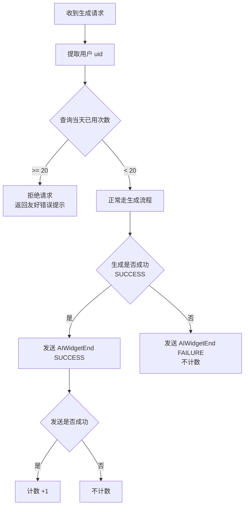

# 用户每日生成次数限流方案

> 功能：限制每个用户每天最多使用 20 次生成服务
> 版本：v1.0（原始需求草案；实际实施以以下确认口径为准）

## 实施确认（2026-10-22）

- 实际项目路径为 `widget_service/`；Python 调用内部 HTTP API，不直连 MySQL、不做并发预占。
  持久化及去重由 API 服务实现；建表脚本仅保留为 API 服务端的参考。
- 按 `uid + requestId` 唯一去重；requestId 沿用 `sessionId&interactionId` 及现有兼容取值。
- 同一 requestId 成功多次或跨天重复调用仅计一次，不阻止再次生成，也不复用结果。
- 每日默认 20 次；北京时间自然日，归属首次成功请求在入口检查时的日期。
- 三个生成接口的新建和编辑共用额度；查询接口不检查。
- 仅业务 `success` 且实际发出 `AIWidgetEnd SUCCESS` 成功才计次；`degraded` 不计次。
- uid 或 requestId 缺失时放行且不计次。指令关闭或发送失败均不计次。
- 检查在 arguments 修复之前，避免超限后仍调用修复模型。
- 查询 API 失败拒绝本次生成；成功交付后记录 API 失败有限重试并告警，不改变已交付结果。
- 已计次的 requestId 不再因当天额度耗尽而被重复拦截。
- 不承诺并发、空标识或进程崩溃时绝对不超额；发送成功仅指服务端发送未报错，不是端侧 ACK。
- 下文的原始双方法示例、纯 uid/date 计数接口及原子自增说明保留作为需求背景，不是最终实现合同。
- 建表与上线说明见 [微服务每日次数说明](../widget_service/docs/用户每日次数限制.md)。

---

# 1. 需求分析

## 1.1. 需求背景

为避免单个用户过度调用生成式 UI 服务、保护模型与算力资源，需要对每个用户每天的使用次数进行限制。当用户当天使用次数达到上限后，直接拒绝后续请求并返回友好错误提示。

## 1.2. 需求内容

- 限制每个用户每天最多使用 **20 次**生成服务（自然日）
- 每次任务执行前检查该用户当天已使用次数是否达到 20 次
- 未达 20 次则正常走生成流程
- 生成成功（SUCCESS）且 AIWidgetEnd 指令发送成功后，记录次数 +1
- 达到 20 次后直接拒绝请求，返回友好错误提示

## 1.3. 需求确认

| 决策点 | 确认结果 |
|--------|---------|
| 计数时机 | 仅**生成成功**（SUCCESS）且 **AIWidgetEnd 指令发送成功**时计数 +1 |
| 存储 | 存**数据库**（本方案不写具体实现） |
| 时间粒度 | **自然日**（每天 0 点重置） |
| 超限处理 | **直接拒绝**并返回友好错误提示 |

---

# 2. 技术方案设计

## 2.1. 整体方案说明

限流逻辑落在 **genui-agent（Python 核心生成服务，端口 8855）** 中，因为 AIWidgetEnd 指令在此服务中发送。方案包含两个核心环节：

- **执行前检查（入口拦截）**：收到生成请求后、调用业务 handler 之前，检查用户当天已用次数，达到上限则拒绝。
- **成功回写（计数 +1）**：生成成功（SUCCESS）且 AIWidgetEnd 指令发送成功后，记录一次成功使用。

计数数据持久化到**数据库**，按 `uid + 自然日` 维度记录，每天 0 点自然重置（新的一天查询不到记录即为 0）。

## 2.2. 涉及的关键代码位置

| 环节 | 文件 | 函数 | 位置说明 |
|------|------|------|---------|
| 执行前检查 | `genui-agent/cloud/api/routes.py` | `_serve_operation_websocket` | 解析出 `request` 后、调用 `handler` 之前 |
| 成功回写 | `genui-agent/cloud/api/routes.py` | `_send_widget_directive_command` | 发送 SUCCESS 状态 AIWidgetEnd 且 `sent=True` 之后 |

## 2.3. uid 获取来源

uid 从 WebSocket 原始请求报文 `payload` 中提取，复用现有函数 `_trace_uid_from_raw_payload(payload)`（位于 `genui-agent/cloud/api/routes.py`）。该函数按以下优先级取第一个非空值：

| 优先级 | 来源字段 | 说明 |
|--------|---------|------|
| 1 | `content.uid` | 新协议 content 中的 uid |
| 2 | `userAuth.user.userId` | 用户鉴权信息中的 userId |
| 3 | `content.arguments.uid` | content.arguments 为字符串时，解析后取 uid |
| 4 | `arguments.uid` | 旧协议 arguments 中的 uid |
| 5 | `payload.uid` | 顶层 payload 中的 uid |

> 说明：`_trace_uid_from_raw_payload` 在参数修复前提取 uid，不改变正式请求归一化规则，与现有 Trace 链路使用同一 uid 来源，保证限流计数与业务归属一致。

## 2.4. 核心流程



## 2.5. 模块设计

新增限流服务模块 `genui-agent/cloud/services/daily_usage_limiter.py`，提供两个核心方法：

```python
class DailyUsageLimiter:
    """用户每日生成次数限流器（自然日，上限 20 次）。"""

    DAILY_LIMIT = 20  # 每日上限

    def check_and_allow(self, uid: str) -> bool:
        """执行前检查：查询用户当天已用次数，<20 返回 True（允许），>=20 返回 False（拒绝）。"""

    def record_success(self, uid: str) -> None:
        """AIWidgetEnd 成功发送后调用：记录一次成功使用（计数 +1）。"""
```

### 2.5.1. 存储层接口

本方案不写具体实现，仅定义数据访问接口：

| 接口 | 说明 |
|------|------|
| `query_daily_count(uid, date)` | 查询指定用户指定自然日的已用次数 |
| `increment_daily_count(uid, date)` | 指定用户指定自然日计数 +1（需保证原子性） |

数据表按 `uid + 自然日` 维度记录计数，每天 0 点自然重置。

## 2.6. 配置项

在 `genui-agent/cloud/config/config.py` 的 `Settings` 中新增配置：

```python
# 用户每日生成次数限流
enable_daily_usage_limit: bool = CONFIG.get("enable_daily_usage_limit") == "true"  # 总开关
daily_usage_limit: int = CONFIG.get("daily_usage_limit", 20)  # 每日上限，默认 20
```

## 2.7. 超限拒绝的友好提示

达到 20 次后，拒绝请求并返回友好错误提示，例如：

> "今日 AI 卡片生成次数已达上限，请明天再尝试。"

---

# 3. 边界情况处理

| 场景 | 处理方式 |
|------|---------|
| uid 为空 | 无法识别用户时，走兜底正常流程（不拦截、不计数），不影响本地联调 |
| 计数失败 | 计数 +1 失败不阻断生成流程（仅记日志），避免影响正常业务 |
| 并发安全 | 计数 +1 需保证原子性（数据库层面处理，本方案不写具体实现） |
| 仅生成接口限流 | 只对 `GENERATION_OPERATIONS`（3 个生成接口）生效，查询接口不受限 |
| 生成失败（FAILURE） | 发送 AIWidgetEnd FAILURE，不计数 |
| AIWidgetEnd 发送失败 | 不计数（仅当发送成功才计数） |

---

# 4. 验收范围

- 每个用户每天最多成功使用 20 次生成服务
- 第 21 次请求被拒绝并返回友好错误提示
- 跨自然日计数重置（新的一天可再次使用）
- 生成失败不占用次数


-- t_genuiagent_html_task: GenUI 生成HTML文件表
CREATE TABLE IF NOT EXISTS t_genuiagent_html_task (
    id                        VARCHAR(64)    NOT NULL COMMENT '主键ID',
    file_id                   VARCHAR(256)    DEFAULT NULL COMMENT '文件ID',
    file_url                  TEXT           DEFAULT NULL COMMENT '文件URL',
    description               TEXT           DEFAULT NULL COMMENT '文件描述',
    create_time               DATETIME       NOT NULL DEFAULT CURRENT_TIMESTAMP COMMENT '创建时间',
    modify_time               DATETIME       NOT NULL DEFAULT CURRENT_TIMESTAMP ON UPDATE CURRENT_TIMESTAMP COMMENT '更新时间',
    PRIMARY KEY (id),
    UNIQUE KEY uk_file_id (file_id)
) ENGINE=InnoDB DEFAULT CHARSET=utf8mb4 COMMENT='GenUI生成HTML文件表';
